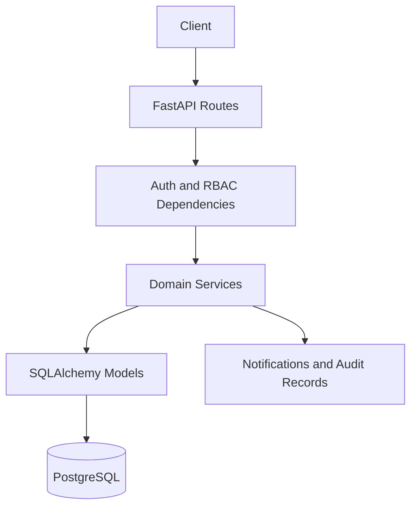
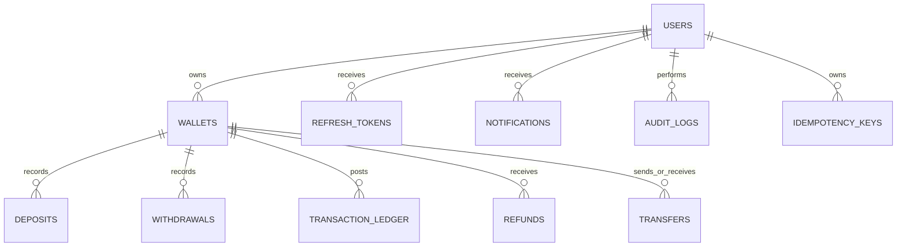

# Digital Wallet & Transaction Processing Platform

Production-oriented REST API for a digital wallet platform built with **FastAPI**, **PostgreSQL**, **SQLAlchemy 2.0 (async)**, **Alembic**, **Pydantic v2**, and **JWT**.

## Features

- **Authentication**: JWT access + refresh tokens, rotation, revocation, password hashing (bcrypt)
- **RBAC**: Super Admin, Admin, Support Agent, Customer
- **Wallets**: Create, list, freeze/unfreeze with status transition rules
- **Deposits / Withdrawals / Transfers**: Atomic balance updates
- **Immutable Transaction Ledger**: Every balance change recorded
- **Concurrency Safety**: `SELECT … FOR UPDATE` row-level locking, deterministic lock ordering
- **Idempotency**: `Idempotency-Key` header for deposit / withdrawal / transfer
- **Transaction Limits**: Configurable max amount, daily transfer/withdrawal limits, max tx/day
- **Suspicious Transaction Flagging**: Amount threshold based
- **Refunds**: Request → Approve / Reject workflow
- **Notifications** & **Audit Logs**
- **Dashboards**: Admin, Support, Customer
- **Centralized domain errors** with consistent JSON shape
- **OpenAPI / Swagger** at `/docs`
- **Docker Compose** ready
- **Pytest** suite (auth, wallet, transfer, concurrency basics, idempotency)

## Architecture

```
Routes → Dependencies (auth, RBAC) → Services (business rules) → Models → PostgreSQL
```

Business rules live in the **service layer**, not in route handlers.

### Concurrency Strategy

1. All balance-mutating operations run inside a single database transaction.
2. Wallets are locked with `SELECT … FOR UPDATE` before reading/updating balance.
3. For transfers, wallets are locked in **deterministic ID order** to avoid deadlocks.
4. Check constraints (`available_balance >= 0`) provide a final safety net.
5. Idempotency keys prevent duplicate financial side-effects on retries.
6. Unique constraints on reference numbers and idempotency keys.

## Quick Start

### Prerequisites

- Docker & Docker Compose **or**
- Python 3.11+, PostgreSQL 14+

### Option A – Docker Compose (recommended)

```bash
cp .env.example .env
docker compose up --build
```

API: http://localhost:8000
Docs: http://localhost:8000/docs
Health: http://localhost:8000/health

On first startup the bootstrap Super Admin uses `FIRST_SUPERUSER_EMAIL` and
`FIRST_SUPERUSER_PASSWORD` from `.env`. Set a unique password before starting.

### Option B – Local

```bash
python -m venv .venv
source .venv/bin/activate   # Windows: .venv\Scripts\activate
pip install -r requirements.txt

# Start PostgreSQL and set DATABASE_URL in .env
cp .env.example .env

# Tables are currently initialized from SQLAlchemy metadata on startup.
# The Alembic directory is not yet populated with a baseline migration.

uvicorn app.main:app --reload --host 0.0.0.0 --port 8000
```

## API Overview

| Method | Endpoint | Description |
|--------|----------|-------------|
| POST | `/api/auth/register` | Register customer |
| POST | `/api/auth/login` | Login → tokens |
| POST | `/api/auth/refresh` | Rotate tokens |
| POST | `/api/auth/logout` | Revoke refresh token |
| GET | `/api/auth/me` | Current user |
| POST | `/api/auth/change-password` | Change password |
| POST | `/api/wallets` | Create wallet |
| GET | `/api/wallets` | List wallets |
| GET | `/api/wallets/{id}` | Get wallet |
| PATCH | `/api/wallets/{id}` | Update name |
| POST | `/api/wallets/{id}/freeze` | Freeze (Support+) |
| POST | `/api/wallets/{id}/unfreeze` | Unfreeze |
| POST | `/api/wallets/{id}/deposits` | Deposit (Idempotency-Key) |
| POST | `/api/wallets/{id}/withdrawals` | Withdraw |
| POST | `/api/transfers` | Transfer |
| GET | `/api/transfers` | List transfers |
| GET | `/api/deposits` | List deposits |
| GET | `/api/withdrawals` | List withdrawals |
| POST | `/api/refunds` | Request refund |
| POST | `/api/refunds/{id}/approve` | Approve refund |
| POST | `/api/refunds/{id}/reject` | Reject refund |
| GET | `/api/transactions` | Ledger (paginated) |
| GET | `/api/notifications` | Notifications |
| PATCH | `/api/notifications/{id}/read` | Mark read |
| PATCH | `/api/notifications/read-all` | Mark all read |
| GET | `/api/admin/transaction-limits` | Get limits |
| PATCH | `/api/admin/transaction-limits` | Update limits |
| GET | `/api/admin/dashboard` | Admin dashboard |
| GET | `/api/admin/support-dashboard` | Support dashboard |
| GET | `/api/admin/my-dashboard` | Customer dashboard |

## Error Format

```json
{
  "success": false,
  "error": {
    "code": "INSUFFICIENT_BALANCE",
    "message": "Insufficient wallet balance."
  }
}
```

Domain codes: `INSUFFICIENT_BALANCE`, `WALLET_FROZEN`, `WALLET_CLOSED`, `INVALID_TRANSFER`, `DUPLICATE_TRANSACTION`, `TRANSACTION_LIMIT_EXCEEDED`, `DUPLICATE_IDEMPOTENCY_KEY`, `INVALID_REFUND`, `SUSPICIOUS_TRANSACTION`, …

## Testing

```bash
pytest -v --cov=app
```

## Database Design (core tables)

- `users`, `roles`
- `wallets` (available_balance, pending_balance, status)
- `deposits`, `withdrawals`, `transfers`
- `transaction_ledger` (immutable)
- `refunds`
- `transaction_limits`
- `suspicious_transactions`
- `notifications`
- `audit_logs`
- `refresh_tokens`
- `idempotency_keys`

Check constraints enforce non-negative balances and positive amounts. Indexes support common filters and foreign keys.

### Architecture diagram



### ER diagram (core relationships)



## Assignment coverage and known gaps

This archive is a strong starter implementation, not a complete fulfillment of every listed requirement. Implemented routes and workflows are discoverable in Swagger at `/docs`; currently missing from the API are entity detail and cancellation routes for deposits, withdrawals, and transfers, refund listing/detail, transaction suspicious-review endpoints, full status/date/amount/search/sort history filters, user administration, and richer suspicious-transaction rules. Scheduled jobs (limit reset, cleanup, scanning, summaries, retries, reports) and a populated Alembic baseline migration are also not present. The included Postman collection and tests cover only a subset of the assignment. These omissions require further implementation and integration testing before representing this as fully assignment-complete or production-ready.

## Production Notes

1. Set unique `SECRET_KEY`, `FIRST_SUPERUSER_PASSWORD`, and `POSTGRES_PASSWORD` in `.env`.
2. Add and review an Alembic baseline migration; the current app uses `create_all` at startup.
3. Enable HTTPS and proper CORS origins.
4. Consider Redis for distributed locking / rate limiting and Celery for background jobs (scheduled limit resets, retries, reports).
5. Add rate limiting and structured logging.

## License

MIT – for assignment / evaluation purposes.
